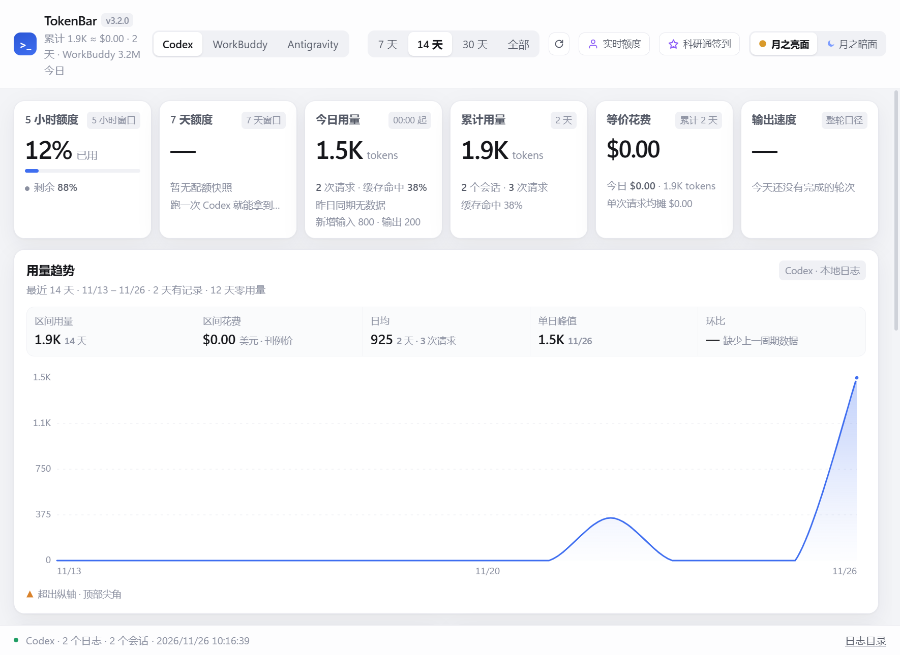
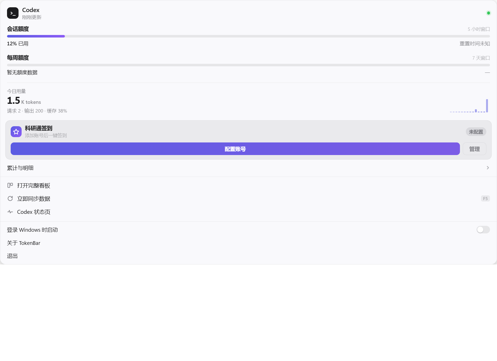
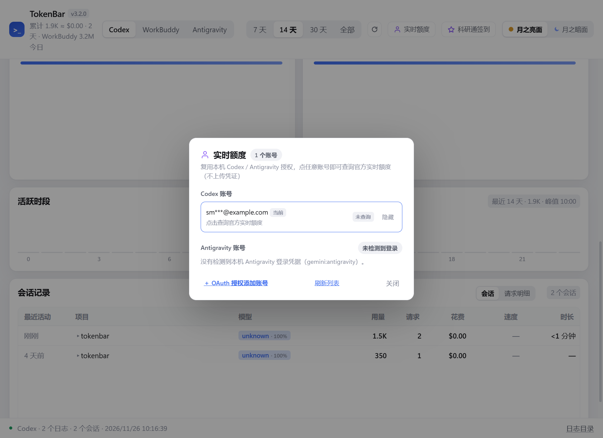
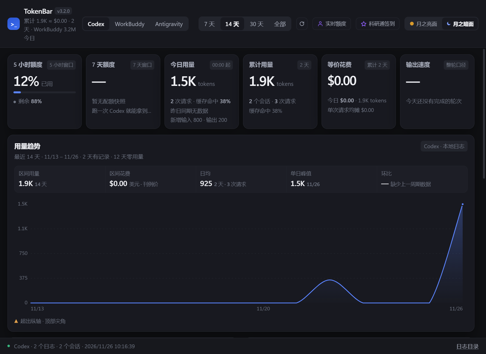
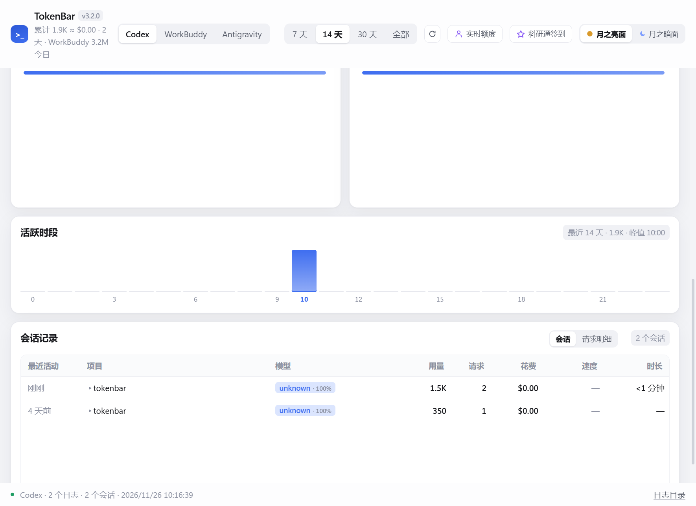

# TokenBar

<p align="center">
  <a href="https://github.com/xiaoqi8553/tokenbar/actions/workflows/ci.yml"></a>
  <a href="https://github.com/xiaoqi8553/tokenbar/releases/latest"></a>
  
  <a href="https://github.com/xiaoqi8553/tokenbar/releases"></a>
  <a href="./LICENSE"></a>
  
</p>

A local-first desktop dashboard for your Codex, WorkBuddy & Antigravity token usage.

Windows 托盘里的 token 用量看板：用了多少、折多少钱、跑得多快，点一下图标就能看到。

<figure>
<picture>
  <source media="(prefers-color-scheme: dark)" srcset="docs/shots/dashboard-dark.png">
  <source media="(prefers-color-scheme: light)" srcset="docs/shots/dashboard-light.png">
  
</picture>
<figcaption>完整看板：额度、用量、花费、速度与按天趋势一屏看全，明暗双主题随你挑。</figcaption>
</figure>

## Why TokenBar

TokenBar 没有账号，也没有服务端。会话内容不会离开这台机器，读日志、算数字、画图都在本地完成。

TokenBar tries to achieve the following goals:

- **本地优先**：tokens、速度、模型 / 项目分布只读本地日志，不上传；应用无后端、无账号体系。
- **复用已有授权**：实时额度直接读本机 Codex 登录与 Antigravity 登录（`gemini:antigravity` 钥匙串）查官方实时额度，不新增一套登录，30 秒刷新一次。
- **口径透明**：累计、花费、速度怎么算都写在下面，去重前后的数字和取舍都有记录，可以自己对账。
- **多源聚合**：Codex、WorkBuddy（国内 / 国际版）与 Antigravity 的日志汇到同一套图表，按会话与请求去重。
- **隐私默认**：token 不出主进程，凭证用系统密钥库加密，隐藏账号只从看板隐藏、不删本地文件。

## Features

左键点托盘图标看弹窗，双击看完整看板。三个数据源共用同一套图表，顶栏可切换 `Codex` / `WorkBuddy` / `Antigravity`。

| 功能 | 一句话 |
| --- | --- |
| 额度窗口 | Codex（5h / 7 天）与 Antigravity（Gemini、Claude / GPT 两组 5h / 每周）已用、剩余与重置时刻；拿到实时额度时标注「实时」。 |
| 今日与趋势 | 今日用量、请求数、缓存命中率与 14 天迷你柱图；看板趋势可切 7 / 14 / 30 天与全部，0 token 日保留占位。 |
| 模型 / 项目分布 | 全量列出，行尾带金额与 tok/s，点行展开新增输入 / 缓存命中 / 输出 / 请求 / 花费 / 速度。 |
| 活跃时段 | 24 小时 × 用量，或切到 tok/s 看每个整点的输出速度。 |
| 会话记录 | 「会话」按模型展开明细；「请求明细」一行一个「会话 × 模型」的扁平日志，视图选择会被记住。 |
| 实时额度 | 列出本机检测到的 Codex 与 Antigravity 账号，点脱敏邮箱即查官方额度；Codex 可选 OAuth 设备码添加账号。 |
| 科研通签到 | 多账号串行签到，状态徽标、积分与连续天数，密码加密只存本机。 |
| 双主题 | 「月之亮面」/「月之暗面」，选择记住；没选过时跟随系统明暗。 |

每张截图点开看原图：

<table>
  <tr>
    <td><a href="docs/shots/popover.png"></a><br><b>托盘弹窗</b> — 额度、今日用量、等价花费与签到入口。</td>
    <td><a href="docs/shots/auth-panel.png"></a><br><b>授权面板</b> — 本机 Codex 账号、OAuth 设备码授权与隐藏账号。</td>
  </tr>
  <tr>
    <td><a href="docs/shots/dashboard-light.png"></a><br><b>完整看板 · 月之亮面</b> — 六张指标卡与按天趋势。</td>
    <td><a href="docs/shots/dashboard-dark.png"></a><br><b>完整看板 · 月之暗面</b> — 同一套图表的暗色主题。</td>
  </tr>
  <tr>
    <td colspan="2"><a href="docs/shots/dashboard-hours.png"></a><br><b>活跃时段</b> — 24 小时 × 用量 / tok/s 切换。</td>
  </tr>
</table>

## Quick start

仓库里是源码，没有直接下载的 exe；先构建一次。

```bash
npm install
npm run desktop:dir        # 免安装目录 → release/desktop/win-unpacked/TokenBar.exe
npm run desktop:build      # NSIS 安装程序 → release/desktop/TokenBar-Setup-<version>.exe
npm run desktop:shortcut   # 桌面快捷方式
```

1. **启动即扫描**：双击 `TokenBar.exe`（或桌面快捷方式），应用自动读 `~/.codex/sessions/**/*.jsonl`、`~/.workbuddy` / `~/.workbuddy-ai`（WorkBuddy 会话在 `~/.workbuddy-ai/projects/**/*.jsonl`）以及 Antigravity（`~/.gemini/antigravity*`、`~/.cc-switch/agy` 等根目录下的 `brain/*/transcript_full.jsonl`）日志，缓存写在 `%APPDATA%/TokenBar/data/`。关窗口不退，图标常驻托盘。
2. **可选：查实时额度**：顶栏点「实时额度」，选本机检测到的 Codex 账号；要加账号就走「＋ OAuth 授权添加账号」的设备码流程。token 只在主进程内存里过一下。
3. **可选：科研通签到**：在弹窗或看板添加科研通账号，点「签到」串行签到全部账号；不点就不联网。

需要看原始数据时用开发命令：

```bash
npm install
npm start                  # Electron 开发模式
npm test                   # 数据层 + UI 断言，120 个测试
npm run desktop:smoke      # 启动、托盘、窗口生命周期
```

生产依赖 **0** 个，devDependencies 只有 electron / electron-builder / playwright。

## Accounting

三个数字最容易算错：累计、花费、速度。下面写清楚每个怎么算，以及为什么。

### Total / 累计

日志里有两套数字，混用会算出离谱的总量。**累计 = 磁盘日志 ∪ 历史索引，按请求指纹全局去重后相加。**

一条请求的指纹是它的用量五元组 `(input, cached_input, output, total, reasoning_output)`。旧索引记录和磁盘上的 `token_count` 事件共用 `event-dedupe.cjs`：历史索引里记过的请求，磁盘上若还留着同一份 rollout 就跳过。两边互补，可以直接相加。

| 口径 | 本机结果 | 结论 |
| --- | --- | --- |
| 请求指纹去重，磁盘 + 索引相加 | 144 天 **5.13B** | UI 采用 |
| 旧：按天取大者，索引未去重 | 6.58B | 多算 **1.36B**，fork replay 最多算 4 次 |
| 只算磁盘日志（去重后净增） | 0.50B | 早期 rollout 已被清理 |
| 每个文件累加最后一个 `total` | 3.78B | 错，resume 会话重复计 |
| 每会话取最大 `total_token_usage` 相加 | 6.1B | 错，resume 会话带着旧总量 |

两个坑方向相反：`resume` / `fork` 把此前整段会话重放进新 rollout 文件，按 `file:line` 累加就把同一批请求算很多遍；Codex 又会清理旧 rollout，磁盘只剩最近一段。本机 2026-07-24 的四个 rollout 文件有 **721～746 轮完全相同的公共前缀**，四份全加是 365.8M，去重后只有 94.7M。

旧的「按天取大者」是在分不清同一请求时的近似。重建 v3 基线后，从 42,151 条索引记录里剔掉 **10,607 条 replay / 1.357B**，Codex 累计从 6.58B 降到 5.13B。作为参照，CC Switch v4 在这台机器上显示 4.87B（只含 Codex）：8 月以后两边逐日吻合，差的约 0.26B 是 CC Switch 从未导入的 `.zst` / `archived_sessions` 历史请求，是真实用量不是重复。WorkBuddy 另加约 0.45B，别拿合计去比 CC Switch 的 Codex 单源数字。

基线版本 3、用量缓存版本 4、明细缓存版本 7 会让旧缓存自动失效，升级后首次启动重建一次（本机约 1.5 秒）。不会手工改写 `userData` 里的原始文件，删缓存只触发重扫。

### Cost / 花费

看板上的金额是按 API 刊例价折算的**等价金额**，不是订阅实扣。Plus / Max 是包月，这些 token 并没有逐笔付钱；这个数字回答的是「如果走 API 要花多少」。

```text
cost = new input / 1e6 × input price
     + cache hit / 1e6 × cached price
     + output    / 1e6 × output price

new input = inputTokens - cachedInputTokens
```

三个常见错误：

- **别拿 `inputTokens` 直接乘输入价**。两家厂商都把缓存命中算进 `inputTokens`，命中率常在 95% 以上，直接乘会把花费放大好几倍。
- **别把 reasoning 单独计费**。各家都已经把它算进 `output_tokens`。
- **统一币种**。人民币计价的模型原样相加，美元计价的除以 `usdCny`（默认 7.2），这样 Codex、WorkBuddy 和 Antigravity 的钱能加到一起，最后统一以 `$` 显示。

模型名按最长前缀匹配：`glm-5.3-flashx` 优先于 `glm-5.3-flash`，再优先于 `glm-5.3`。表里没有的型号按兜底价估算并标「估算」——宁可估，不记 0。单价表在 `%APPDATA%/TokenBar/data/pricing.json`，改完重开看板生效。

### WorkBuddy

每次模型调用带一份 usage：`inputTokens`（含缓存）、`outputTokens`、`cached_tokens`、`reasoning_tokens`、`rawUsage.credit`。

- **不能按 `conversationRequestId` 去重**。一次请求拆成十几个 step，每个 step 各带一份 usage；按请求 ID 去重会把 985 次压成 27 次。去重键是 `traceId|stepSeq`。
- **输入含缓存**，`新增输入 = input - cached`。本机缓存命中率 98%，两档要分开看。
- **速度从时间戳算，不是现成字段**。Codex 直接给 `duration_ms`，WorkBuddy 用 `function_call_result.timestamp − function_call.timestamp`（按 `parentId` 配对），口径与 Codex 一致。

### Antigravity（对齐 CC Switch 口径）

Antigravity 扫描 CLI（`~/.gemini/antigravity-cli`）、桌面端 / IDE（`~/.gemini/antigravity`）、ACP（`~/.gemini/antigravity-acp`）及私有配置目录下的 `brain/<id>/.system_generated/logs/transcript_full.jsonl`，仅统计 `PLANNER_RESPONSE` 且 `status === "DONE"` 的记录，按 `agy:<sessionId>:<step_index>` 去重：

- **Token 语义不重复扣减**：Antigravity 导出的 `input_tokens` 已经是**新增输入**（不含 `cache_read_tokens`），`output_tokens` 也已经**包含思考 tokens**。TokenBar 内部映射为 `inputTokens = rawInput + cacheRead`，保证「新增输入」「缓存命中」「命中率」及等价花费与 CC Switch 严格一致。
- **模型归属**：优先取响应行 `model`，其次按 `step_index` 顺序继承 `Model Selection` 切换事件；子代理与 Orchestrator（Carbon / Argon / Neon / Hydrogen worker）则以只读方式查询伴生 `conversations/<id>.db`（`steps -> gen_metadata`）还原真实模型与 `-tiered` 档位。
- **速度与 TTFT**：从 `conversations/<id>.db` 读取 `first_token` 与 `streaming` 时长计算 `tok/s` 与首字延迟中位数。

### Speed / 速度

`tps = 输出 tokens ÷ 轮耗时`。这是**整轮吞吐**，不是纯流式解码速度：里面包含工具调用和等待，所以一轮跑了 30 秒 shell 命令的会话会显得慢，哪怕模型秒回。

| 数据源 | 耗时来自 |
| --- | --- |
| Codex | `task_complete.duration_ms`，按 `turn_id` 与 `token_usage_record` 配对 |
| WorkBuddy | `function_call_result.timestamp − function_call.timestamp`，按 `parentId` 配对 |
| Antigravity | `conversations/<id>.db` 中 `gen_metadata` 的 `first_token + streaming` 时长 |

配不上的轮次直接不计入，不当成 0 拉低平均。会话表三个数据源都显示 `tok/s`；WorkBuddy 一轮都配不上时退回显示积分，这一列不会空着。

## Privacy

- **token 不出主进程**：授权 token 只留在 Electron 主进程内存，不进渲染进程、日志或命令行参数；界面只出现脱敏邮箱。
- **无后端、无账号、无遥测**：用量只在本地算，没有任何上传路径；科研通签到只在点击时直连 ablesci.com。
- **凭证加密落盘**：科研通密码优先用 Electron `safeStorage`（Windows 上是 DPAPI），不可用时退回本机派生的 AES-256-GCM，密文只存 `%APPDATA%/TokenBar/data/`。
- **隐藏不等于删除**：「隐藏」只把账号从看板列表挪走，清单存在 TokenBar 自己的配置里；`~/.codex` 下的授权文件一个字节都不动，Codex CLI 照常用。

## FAQ

**为什么 ChatGPT 云端线程不计入？**
Codex Desktop 的云端线程在 `~/.codex/sqlite/codex.db` 里 `source_kind = 'chatgpt'`、没有 `cwd`，磁盘上也不写 rollout，本机只有标题和时间。它照样扣订阅额度，但没有任何 token 明细可算——TokenBar 和 CC Switch 都补不出来。想进看板就用本地会话（CLI / 扩展 / Desktop local 模式），或让请求经过 CC Switch 本地代理。

**为什么金额是美元？**
刊例价表内部保留人民币原价，只在展示边界按 `pricing.json` 的 `usdCny`（默认 7.2）折算成 `$`，这样 Codex、WorkBuddy 和 Antigravity 的钱能加到一起。这个数字是「走 API 要花多少」的等价估算，不是订阅实扣。

**为什么和 CC Switch 的数字对不上？**
看去重口径：重写基线前 TokenBar 是 6.58B，CC Switch v4 是 4.87B；按请求指纹去重后 TokenBar 收敛到 5.13B，8 月以后两边逐日吻合。剩下约 0.26B 是 CC Switch 从未导入的 `.zst` / `archived_sessions` 真实历史请求，不是重复计算。另外 CC Switch 的数字只含 Codex，TokenBar 合计里还有 WorkBuddy 约 0.45B，别拿合计去比单源。

**隐藏账号是不是把本地文件删了？**
不删，点「隐藏」只是让它从看板列表消失，「显示已隐藏的 N 个账号」随时能恢复，`~/.codex` 里的授权文件原封不动。账号多了想眼净——这些玩意怎么清除啊？不用删文件，隐藏一下就够了。

## Contributing

欢迎提 issue 和 PR。改动数据口径请附上本机日志的前后对比数字（像 Accounting 里那样），UI 改动请跑 `npm test`（120 个测试）和 `npm run desktop:smoke`。文档截图由 `npm run docs:shots` 生成，改界面后记得更新。

## License

MIT — 见 [LICENSE](./LICENSE)。
